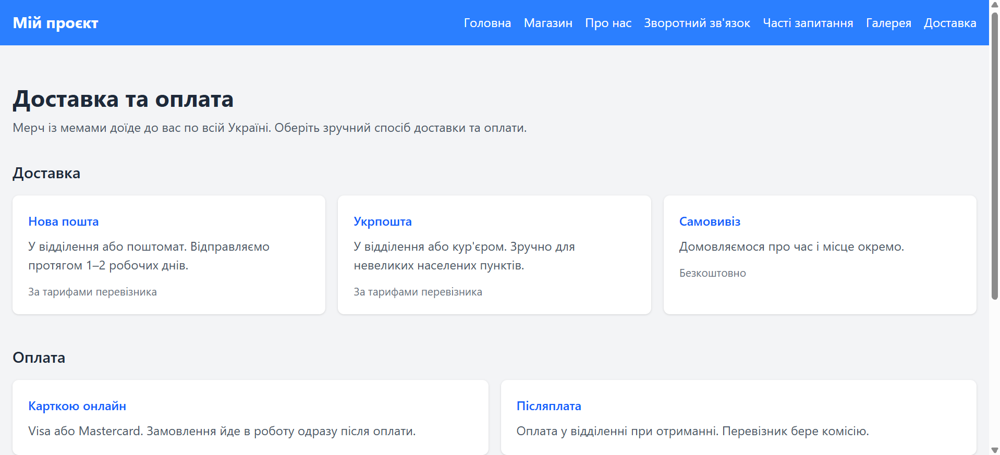
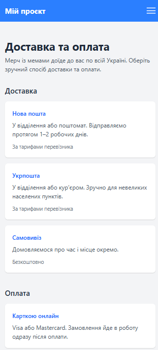

## Звіт про виконання лабораторної роботи №3

- ПІБ: Ковтун Каріна
- Група: ІПЗ-22
- Склад команди: Рудь Максим, Засєкін Ілля, Шутовська Марта, Комарук Марк
- Тема проєкту: інтернет-магазин мерчу з мемами (Flask, Jinja2, Tailwind CSS). Репозиторій: https://github.com/awaikoi/OPI-lab03

### 1. Особистий внесок у командну роботу

- Я додала у проєкт сторінку «Доставка та оплата» (/delivery). Вона містить способи доставки (Нова пошта, Укрпошта, самовивіз), способи оплати та блок поширених запитань, зроблений на елементах 
. Конкретно:

- - створила шаблон templates/delivery.html, який наслідує base.html і використовує Tailwind-класи, узгоджені зі стилем решти сайту;
- - додала маршрут /delivery у app.py;
- - додала пункт «Доставка» в десктопне й мобільне меню в base.html.

Коміти: [коміт №1](https://github.com/awaikoi/OPI-lab03/commit/3d93c6ee6e5def4d1f76af69308da076ce96d22d)

### 2. Скріншоти

Сторінка /delivery у звичайному вигляді:

Сторінка /delivery у мобільному вигляді: 

### 3. Труднощі та їх вирішення

- Після додавання пункту меню в base.html усі сторінки впали з помилкою BuildError, бо маршруту delivery ще не було в app.py. Рішення: додати маршрут і закомітити його разом зі змінами в меню.
- Меню в base.html дублюється для десктопа й мобільних пристроїв, тому посилання довелося додавати в обидва місця.
- Потрібно було вписати нову сторінку в наявний дизайн. Рішення: використати ті самі Tailwind-класи (картки, тіні, ефект при наведенні), що й на інших сторінках.

### 4. Висновки

- У ході роботи я додала до Flask-проєкту нову сторінку на основі базового шаблону та підключила її до навігації. Я закріпила роботу з маршрутами, спадкуванням шаблонів Jinja2 та адаптивною версткою на Tailwind CSS. Командна робота в Git вимагала узгоджувати зміни в спільних файлах, зокрема в base.html.