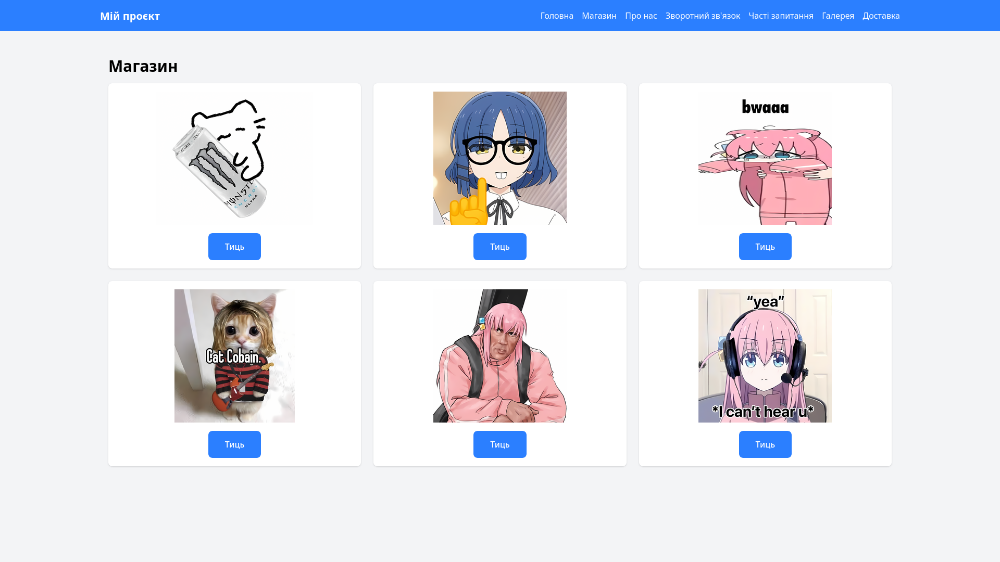
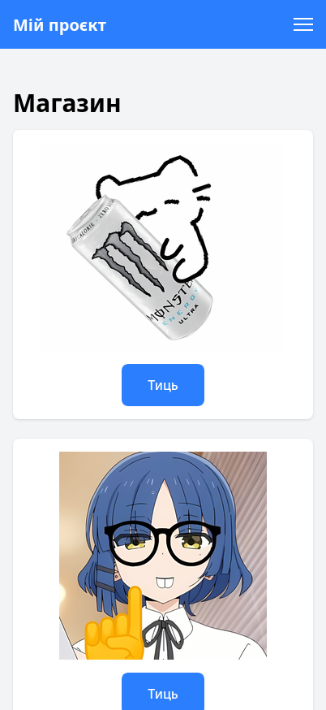

# Звіт до лабораторної роботи №3

## 1. Загальна інформація

- **ПІБ:** Рудь Максим Русланович
- **Група:** ІПЗ-22
- **Тема проєкту:** Розробка вебсайту з використанням мікрофреймворку Flask.
- **Репозиторій:** [OPI-lab03](https://github.com/awaikoi/OPI-lab03)

## 2. Команда проєкту

У розробці вебсайту брали участь такі учасники:

| Учасник         | GitHub                                            |
| --------------- | ------------------------------------------------- |
| Засєкін Ілля    | [NikanoNino](https://github.com/NikanoNino)       |
| Шутовська Марта | [YotsubaNikano](https://github.com/YotsubaNikano) |
| Комарук Марк    | [ItsukiNikano](https://github.com/ItsukiNikano)   |
| Ковтун Каріна   | [k7912341-bit](https://github.com/k7912341-bit)   |
| --------------- | ------------------------------------------------- |

## 3. Мета та завдання проєкту

**Мета роботи** — отримати практичні навички командної розробки вебзастосунків, навчитися використовувати Flask для створення вебсторінок, а також закріпити знання з HTML, CSS та системи контролю версій Git.

У межах проєкту було поставлено такі завдання:

- Створити структуру вебзастосунку на основі Flask.
- Реалізувати маршрутизацію між сторінками.
- Розробити HTML-шаблони з використанням Jinja2.
- Забезпечити єдиний стиль оформлення сторінок.
- Реалізувати адаптивне відображення вебсайту на мобільних пристроях.
- Організувати спільну роботу над проєктом за допомогою Git та GitHub.

## 4. Особистий внесок у командну роботу

У межах командної розробки я відповідав за реалізацію окремої частини вебсайту.

Моя робота включала створення та оформлення сторінки магазину, інтеграцію її в загальну структуру вебзастосунку та забезпечення узгодженості оформлення з іншими сторінками проєкту.

**Виконані завдання:**

- Створення HTML-шаблону сторінки магазину.
- Розробка структури та оформлення вмісту сторінки.
- Додавання необхідних зображень та елементів інтерфейсу.
- Інтеграція сторінки в загальну структуру вебсайту.

**Посилання на коміти:**

- [60a1601](https://github.com/awaikoi/OPI-lab03/commit/60a1601f0051458869260d1ef228979334de7de1) — ініціалізація проєкту.
- [bef804f](https://github.com/awaikoi/OPI-lab03/commit/bef804f41517f39fe7f6113a9ad6764e2587214f) — створення .gitignore.
- [6016a3d](https://github.com/awaikoi/OPI-lab03/commit/6016a3d7e2727abc64a34a7fd8b4adcfe66639e1) — додано картинки.
- [0a68d95](https://github.com/awaikoi/OPI-lab03/commit/0a68d952961c8299aef40ebecc8777444a9efe34) — додавання сторінки магазину.

[Переглянути історію моїх комітів](https://github.com/awaikoi/OPI-lab03/commits?author=awaikoi)

## 5. Результати роботи

У результаті командної роботи було створено вебсайт, що складається з декількох взаємопов'язаних сторінок.

Реалізовані сторінки забезпечують зручну навігацію між розділами, мають спільний стиль оформлення та адаптуються до різних розмірів екранів.

### 5.1. Магазин

**Звичайний вигляд:**

**Мобільний вигляд:**

## 6. Труднощі та способи їх вирішення

Під час розробки виникали труднощі, пов'язані з інтеграцією окремих сторінок у спільний вебзастосунок, узгодженням структури шаблонів та забезпеченням коректного відображення інтерфейсу на різних пристроях.

Для вирішення цих проблем використовувалися можливості Flask та шаблонізатора Jinja2. Спільний базовий шаблон дозволив уніфікувати оформлення сторінок, а засоби CSS — забезпечити адаптивність інтерфейсу.

Також під час командної роботи використовувалися гілки Git та механізм Pull Request на GitHub, що дозволило розділити завдання між учасниками та об'єднати результати їхньої роботи.

## 7. Висновки

У ході виконання лабораторної роботи було отримано практичний досвід командної розробки вебзастосунку з використанням Flask, HTML, CSS та Jinja2. Було закріплено навички роботи з Git і GitHub, зокрема створення окремих гілок, фіксації змін та об'єднання результатів роботи учасників. У результаті було створено багатосторінковий вебсайт з адаптивним інтерфейсом.
