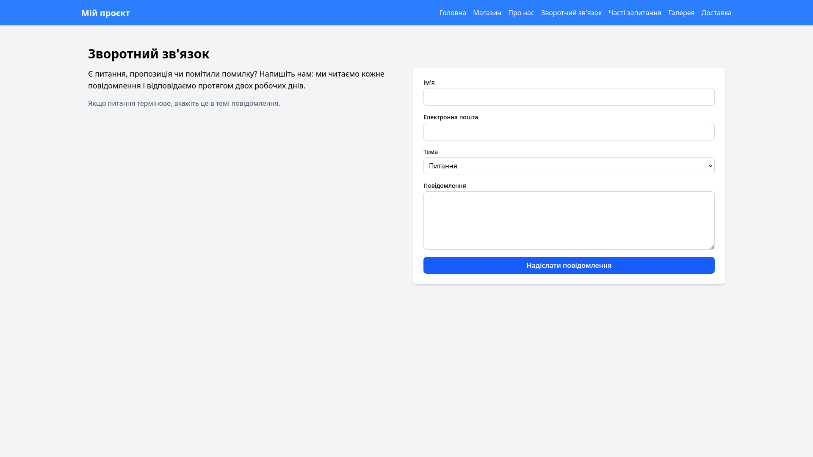
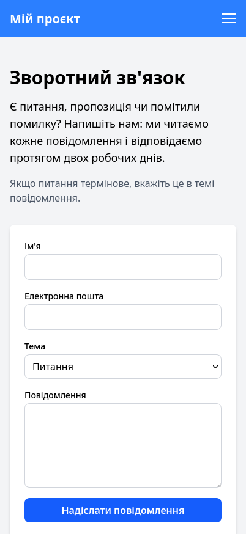

# Звіт до лабораторної роботи №3

## 1. Загальна інформація

| Поле | Значення |
|------|----------|
| ПІБ | Засєкін Ілля Віталійович |
| Група | ІПЗ 22 |
| GitHub | [NikanoNino](https://github.com/NikanoNino) |
| Репозиторій | https://github.com/awaikoi/OPI-lab03 |
| Тема проєкту | Розробка вебсайту з використанням мікрофреймворку Flask. |

### Склад команди

| № | ПІБ | GitHub |
|---|-----|--------|
| 1 | Рудь Максим Русланович | [awaikoi](https://github.com/awaikoi) |
| 2 | Комарук Марк Артемович | [ItsukiNikano] (https://github.com/ItsukiNikano)  |
| 3 | Шутовська Марта Олександрівна | [YotsubaNikano](https://github.com/YotsubaNikano) |
| 4 | Ковтун Каріна Ігорівна | [k7912341-bit] (https://github.com/k7912341-bit) |

## 2. Особистий внесок у командну роботу

Що саме зроблено мною:

- Розробив сторінку «Зворотний зв'язок» (`templates/feedback.html`): текстовий блок із поясненням і форма з полями «Ім'я», «Електронна пошта», «Тема» (випадаючий список), «Повідомлення» та кнопкою відправки; додав клієнтську валідацію (`required`, `type="email"`).
- Зробив адаптивну верстку сторінки за допомогою Tailwind CSS (`grid-cols-1 md:grid-cols-2`): на мобільних пристроях блоки йдуть один під одним, на широких екранах — у дві колонки.
- Додав у `app.py` маршрут `/feedback` і view-функцію `feedback()`.
- Підключив навігацію в `base.html`: замінив заглушки `href="#"` на `url_for('feedback')` та `url_for('shop')` у десктопному та мобільному меню.
- Виправив помилки: конфлікт імен view-функцій (`home()` → `feedback()`) і несумісний із Flask тег `` у шаблоні.

Мої коміти:

| Коміт | Опис |
|-------|------|
| [`6ba2213`](https://github.com/awaikoi/OPI-lab03/commit/6ba2213c15272e128f5fb3af9c04498460ec344a) | додано сторінку зворотнього зв'язку |
| [`c79b096`](https://github.com/awaikoi/OPI-lab03/commit/c79b09609e3340c93e1eaadeb6a52baaac19a336) | виправлення помилки з назвою функції перенаправлення на сторінку зворотнього зв'язку|

Усі мої коміти: https://github.com/awaikoi/OPI-lab03/commits?author=NikanoNino

## 3. Скріншоти створених сторінок

### Сторінка «Зворотній зв'язок»

| Звичайний вигляд (desktop) | Мобільний вигляд |
|----------------------------|------------------|
|  |  |

## 4. Труднощі та їх вирішення

| Труднощі | Як вирішено |
|----------|-------------|
| Форма на вузьких екранах розтягувалась і займала зайве місце. Текст і форма стояли двома колонками, які на телефоні не вміщались. | Використав адаптивну сітку Tailwind grid-cols-1 md:grid-cols-2: на мобільних блоки йдуть один під одним, а на широких екранах стають у дві колонки. Поля отримали клас w-full, щоб заповнювати доступну ширину. |
| Сторінка зворотного зв'язку не відкривалась через помилку TemplateSyntaxError: Encountered unknown tag 'csrf_token'. Тег  належить Django, а Flask використовує Jinja2 без цього тега, тому шаблон не компілювався. | Видалив  з форми в feedback.html. Після цього сторінка відображається коректно, а форма працює. За потреби захист від CSRF у Flask можна додати через розширення Flask-WTF. |

## 5. Висновки

Під час виконання лабораторної роботи я закріпив навички командної розробки з використанням Git і GitHub: створення гілок, коміти та розв'язання конфліктів під час злиття. Також я попрактикувався у верстці вебсторінок та адаптації їх під мобільні пристрої за допомогою media queries. Ця робота показала, що чітке розподілення завдань у команді та регулярні коміти значно спрощують спільну роботу над проєктом.
