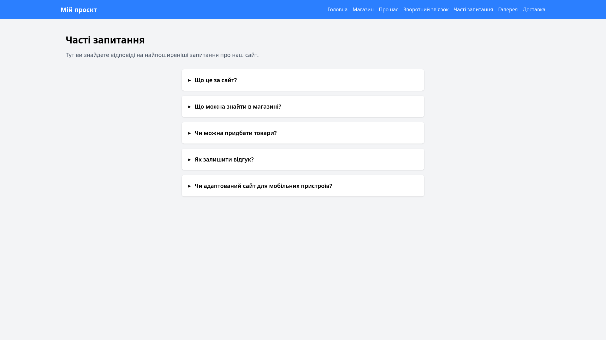
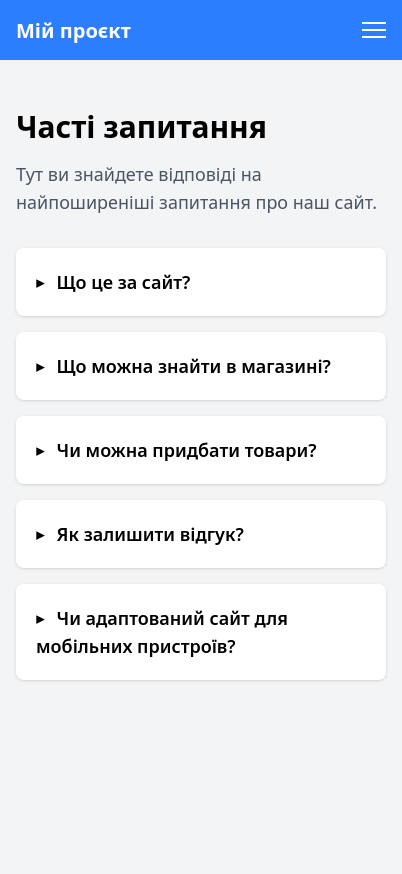

# Звіт до лабораторної роботи №3

## 1. Загальна інформація

- **ПІБ:** Комарук Марк Артемович
- **Група:** ІПЗ 22
- **Тема проєкту:** Розробка вебсайту крамниці мерчу з мемною аніме- та рок-естетикою (Bocchi the Rock, Cat Cobain, Ryo Yamada тощо) з використанням мікрофреймворку Flask.
- **Репозиторій:** [https://github.com/awaikoi/OPI-lab03](https://github.com/awaikoi/OPI-lab03)

## 2. Команда проєкту

У розробці вебсайту брали участь такі учасники:

| Учасник | GitHub |
|---|---|
| Рудь Максим | [awaikoi](https://github.com/awaikoi) |
| Засєкін Ілля | [NikanoNino](https://github.com/NikanoNino) |
| Шутовська Марта | [YotsubaNikano](https://github.com/YotsubaNikano) |
| Ковтун Каріна | [карінф](https://github.com/k7912341-bit) |

## 3. Мета та завдання проєкту

**Мета роботи** — отримати практичні навички командної розробки вебзастосунків, навчитися використовувати Flask для створення вебсторінок, а також закріпити знання з HTML, CSS та системи контролю версій Git.

У межах проєкту було поставлено такі завдання:

- Створити структуру вебзастосунку на основі Flask (`app.py`, `templates/`, `images/shop/`, `requirements.txt`).
- Реалізувати маршрутизацію між сторінками: `/`, `/shop`, `/gallery`, `/about`, `/faq`, `/feedback`.
- Розробити HTML-шаблони з використанням Jinja2; зокрема, галерея отримує дані (зображення, назви, описи) зі списку словників у `app.py`.
- Забезпечити єдиний стиль оформлення сторінок.
- Реалізувати адаптивне відображення вебсайту на мобільних пристроях.
- Організувати спільну роботу над проєктом за допомогою Git та GitHub.

## 4. Особистий внесок у командну роботу

**Виконані завдання:**

- Створив сторінку «Часті запитання» (/faq): шаблон templates/faq.html, який розширює базовий base.html. На сторінці п'ять запитань у вигляді розкривних блоків, оформлених за допомогою Tailwind CSS.
- Додав у app.py маршрут /faq з функцією faq().
- Додав посилання «Часті запитання» в навігацію base.html, і в десктопне, і в мобільне меню (через url_for('faq')).

**Посилання на коміти:**

- https://github.com/awaikoi/OPI-lab03/commit/6100fa6d081ab9351bc0282e465c92181af025e4 — додано сторінку "Часті запитання".

[Переглянути історію моїх комітів](https://github.com/awaikoi/OPI-lab03/commits?author=ItsukiNikano)

## 5. Результати роботи

### 5.1. Часті запитання (`/faq`)

**Звичайний вигляд:**

**Мобільний вигляд:**

## 6. Труднощі та способи їх вирішення

- Труднощі: нову сторінку треба було додати в меню, а в base.html є дві навігації, десктопна й мобільна.
- - Вирішення: додав посилання «Часті запитання» в обидва блоки через url_for('faq'), щоб назва маршруту не прописувалася вручну.

## 7. Висновки

Під час лабораторної роботи ми створили багатосторінковий вебсайт на Flask із маршрутизацією та шаблонами Jinja2, а також навчилися використовувати наслідування шаблонів для єдиного стилю сторінок. Мій внесок — сторінка «Часті запитання» з адаптивним оформленням на Tailwind CSS та її інтеграція в навігацію сайту. Також я здобув практичний досвід командної роботи з Git і GitHub: коміти, перегляд змін колег і запобігання конфліктам при злитті.