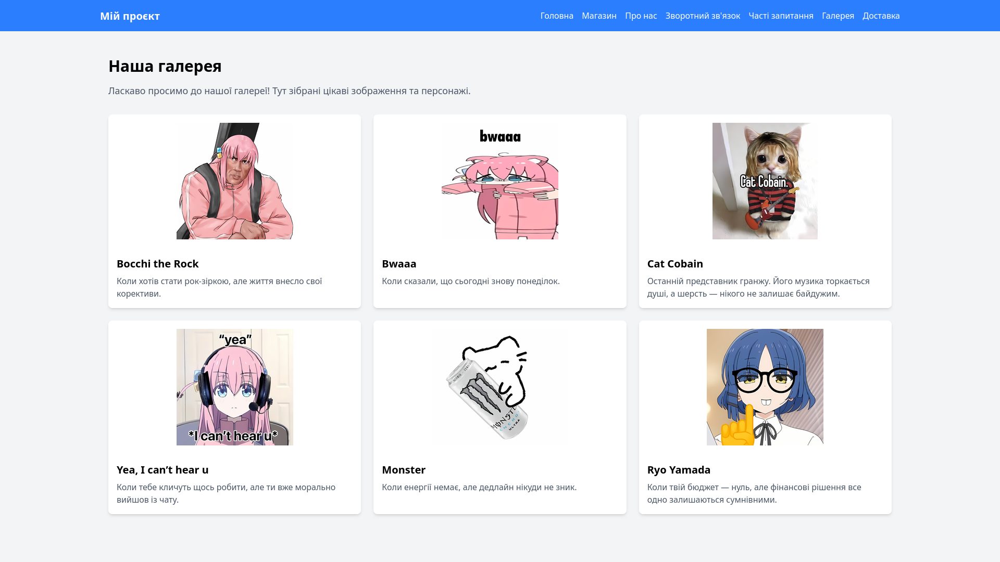
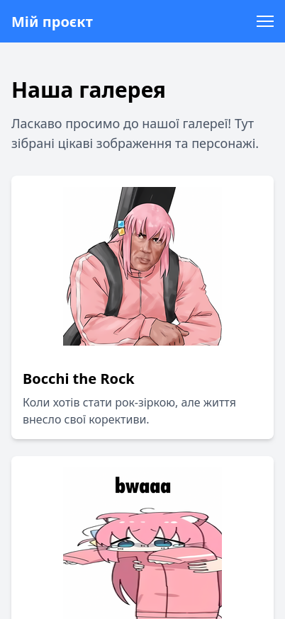

# Звіт до лабораторної роботи №3

## 1. Загальна інформація

| Поле | Значення |
|------|----------|
| **ПІБ** | Шутовська Марта Олександрівна |
| **GitHub-нікнейм** | [YotsubaNikano](https://github.com/YotsubaNikano) |
| **Група** | ІПЗ-22 |
| **Репозиторій** | [awaikoi/OPI-lab03](https://github.com/awaikoi/OPI-lab03) |
| **Склад команди** | 1. Засєкін Ілля Віталійович (NikanoNino) 2. Ковтун Каріна Ігорівна (k7912341-bit) 3. Комарук Марк Артемович (ItsukiNikano) 4. Рудь Максим Русланович (awaikoi) |
| **Тема проєкту** | Розробка вебсайту з використанням мікрофреймворку Flask. |

---

## 2. Особистий внесок у командну роботу

### Що саме зроблено

- створено сторінку `Gallery`
- реалізовано адаптивну верстку для мобільних пристроїв_
- написаний репорт

### Мої коміти

Усі коміти автора: [переглянути в репозиторії](https://github.com/awaikoi/OPI-lab03/commits?author=YotsubaNikano)

| № | Коміт | Опис |
|---|-------|------|
| 1 | [`17a7dbc`](https://github.com/awaikoi/OPI-lab03/commit/17a7dbc676a939a396a07bc2504f1f98114c1c1f)
| 2 | [`be9470d`](https://github.com/awaikoi/OPI-lab03/commit/be9470da5a8dfb103cb07b28e9174d49f36029e1)

### Pull Request-и (за наявності)

- [gallery page](https://github.com/awaikoi/OPI-lab03/pull/7)

---

## 3. Скріншоти створених сторінок

### Сторінка 1: gallery

| Звичайний вигляд (desktop) | Мобільний вигляд |
|:--:|:--:|
|  |  |

---

## 4. Труднощі, що виникли, і як їх вирішено

| Труднощі | Як вирішено |
|----------|-------------|
| Я нервую бо не виходить з першого разу | перестала бути нюньою того дня |

---

## 5. Висновки

Підчас виконання цієї лабораторної роботи я знову працбвала з GitHub що мені сподобалося,також відкрила для себе нове середовище Vizual Studio Code. Працювала в команді, заспокоювала себе і переконувала що все буде добре.
